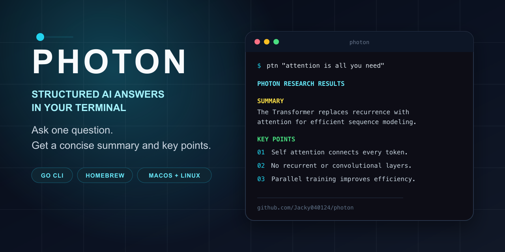
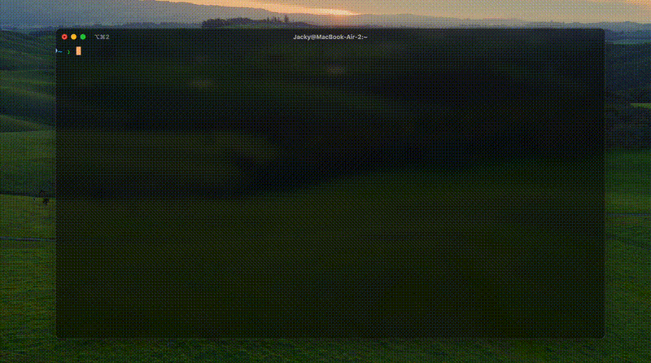

[English](README.md) | [中文](README.zh.md)

# Photon

<p align="center">
  
</p>

<p align="center"><strong>Turn one question into a concise AI summary and key points, without leaving the terminal.</strong></p>

<p align="center">
  <a href="https://github.com/Jacky040124/photon/releases/latest"></a>
  <a href="https://github.com/Jacky040124/photon/actions/workflows/release.yml"></a>
  
  
</p>

## Proof, not promises

| Shipped | Installable | Productized |
| --- | --- | --- |
| Tagged releases publish native binaries for macOS and Linux on Intel and ARM. | A maintained Homebrew formula installs the executable as `ptn`. | The CLI includes a model catalog, interactive selection, persisted configuration, a loading state, and a timeout fallback. |

[See the releases](https://github.com/Jacky040124/photon/releases) · [Inspect the release workflow](.github/workflows/release.yml) · [Inspect the Homebrew formula](https://github.com/Jacky040124/homebrew-photon/blob/main/photon.rb)

## What I built

* A focused command surface with Cobra: ask with `ptn "..."`, or inspect and change the active model with `ptn model`.
* An OpenRouter client and parser that turns model output into consistent `Summary` and `Key Points` sections.
* A terminal experience built with Bubble Tea and Lip Gloss, including an interactive model picker and readable result styling.
* A release pipeline that builds four platform binaries, plus a Homebrew distribution path.

## Real CLI demo

<p align="center">
  
</p>

The recording above is from the real CLI. Response content and latency depend on the selected OpenRouter model.

## Install and run

### Homebrew

```bash
brew tap Jacky040124/photon
brew install photon
```

Create an [OpenRouter API key](https://openrouter.ai/keys), then expose it to Photon:

```bash
export PHOTON_OPEN_ROUTER_KEY="your_openrouter_api_key"
ptn "What problem does the Transformer architecture solve?"
```

Photon renders the answer as a short summary followed by numbered key points.

### Download a binary

The [latest release](https://github.com/Jacky040124/photon/releases/latest) includes builds for:

* macOS on Intel and Apple silicon
* Linux on amd64 and arm64

Download the appropriate file, rename it to `ptn`, make it executable, and place it on your `PATH`.

### Build from source

Photon currently declares Go 1.24.3 in [`go.mod`](go.mod).

```bash
git clone https://github.com/Jacky040124/photon.git
cd photon
go build -o ptn ./cmd
./ptn --help
```

## Model controls

```bash
ptn model list
ptn model current
ptn model set kimi
ptn model info kimi
ptn model reset
```

The selected model is stored in `~/.photon/config.json`. The recommended credential path is the `PHOTON_OPEN_ROUTER_KEY` environment variable shown above.

## How it works

```text
terminal query
    ↓
Cobra command and local model configuration
    ↓
OpenRouter chat completion request
    ↓
Summary and Key Points parser
    ↓
Bubble Tea and Lip Gloss terminal output
```

The implementation is intentionally small. Command handling lives in [`cmd/`](cmd), while the API client, model catalog, parsing, and terminal rendering live in [`pkg/`](pkg).

## Current scope

Photon is a compact AI answer client, not a web search engine. The current release:

* sends one text question to the selected model through OpenRouter
* structures the model response into a summary and key points
* does not browse the web, verify claims, or attach source citations
* depends on OpenRouter model availability, limits, latency, and pricing

That boundary is deliberate: Photon optimizes for a fast terminal workflow and makes no claim that a model response replaces source based research.

## Release pipeline

Tags matching `v*` trigger [GitHub Actions](.github/workflows/release.yml), which builds and attaches these artifacts to a GitHub release:

```text
ptn-darwin-amd64
ptn-darwin-arm64
ptn-linux-amd64
ptn-linux-arm64
```

---

Built by [Jacky Zhong](https://github.com/Jacky040124).
